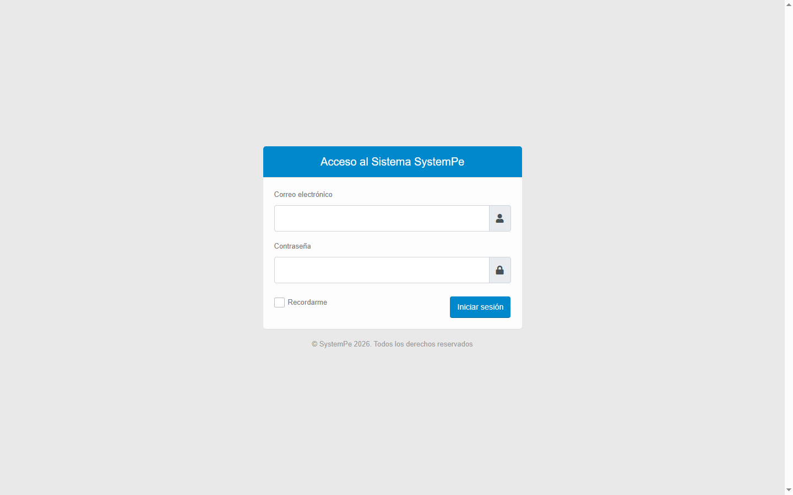
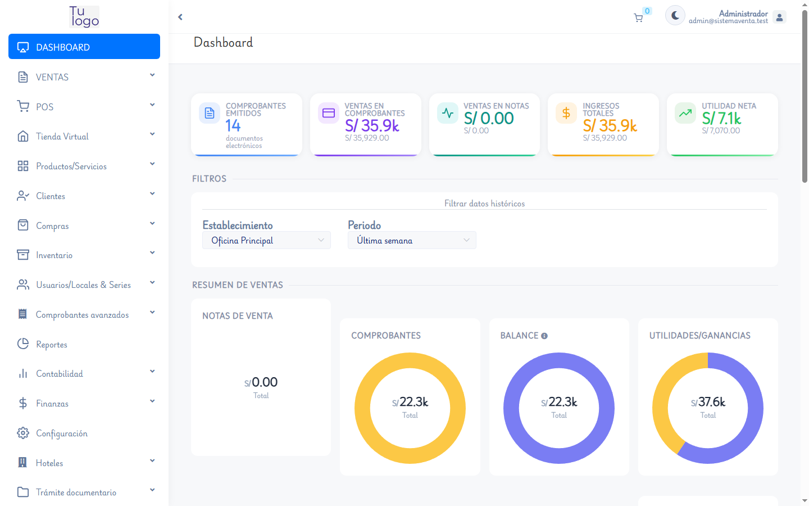
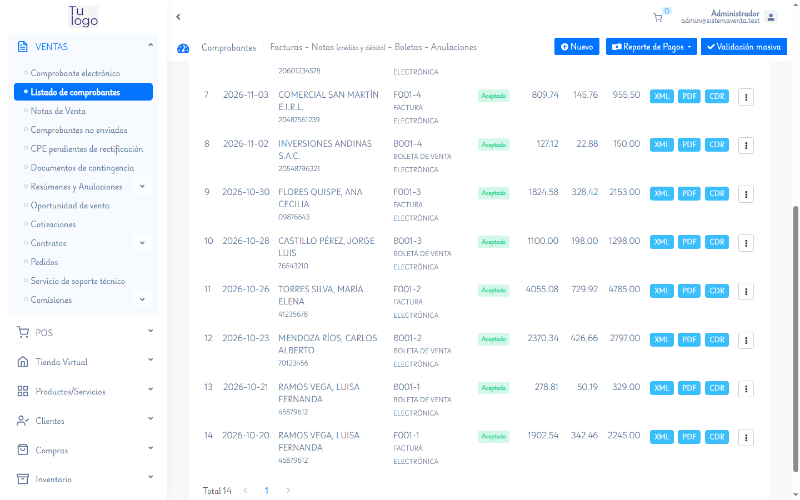
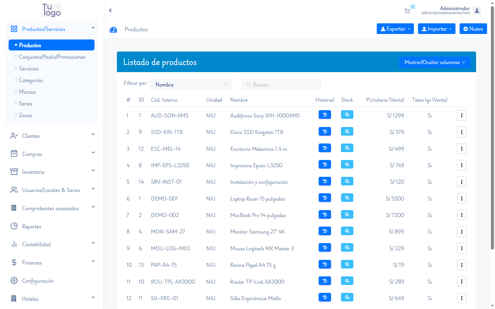
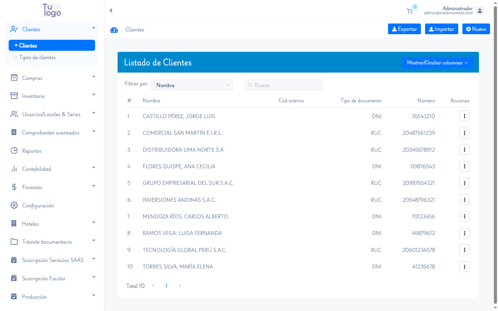
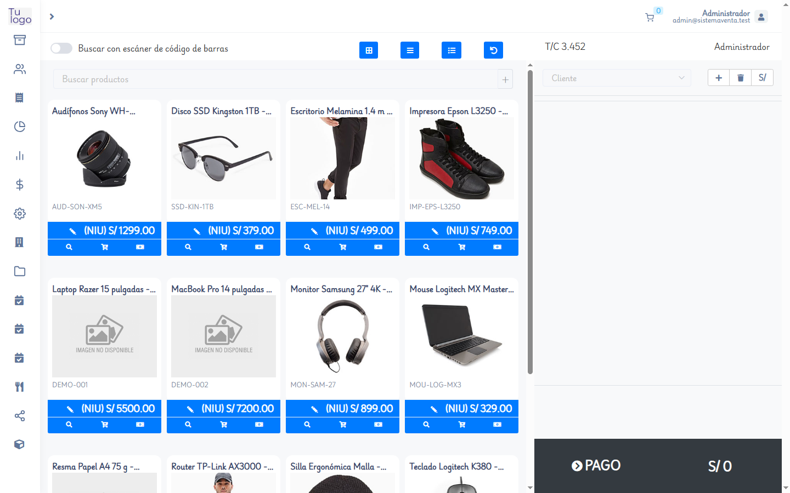
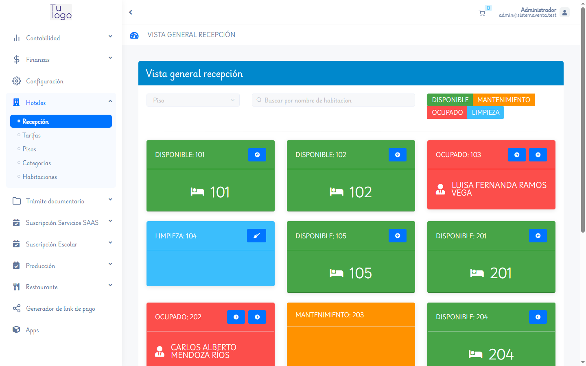
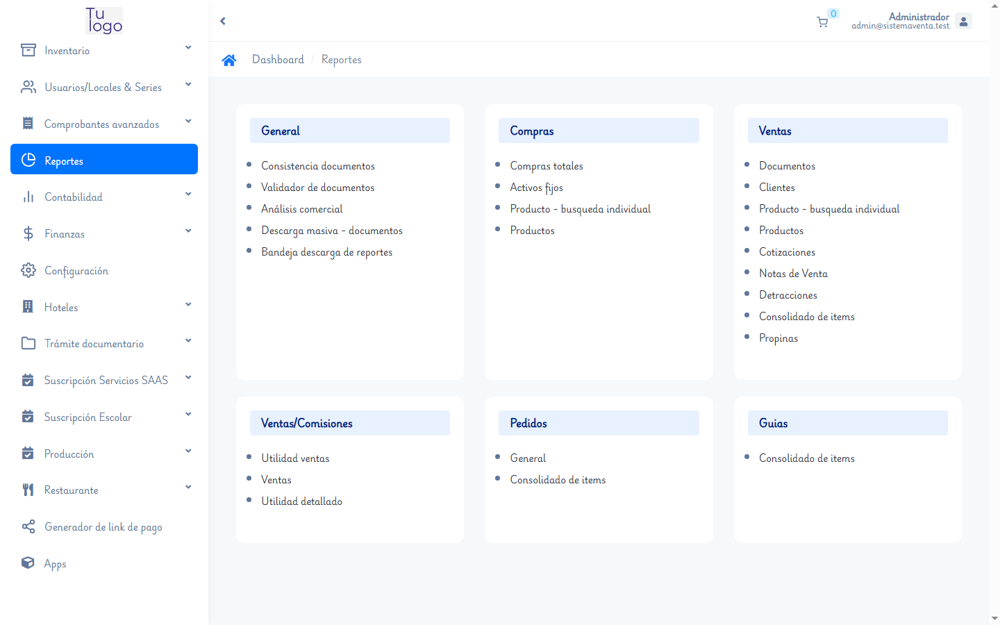
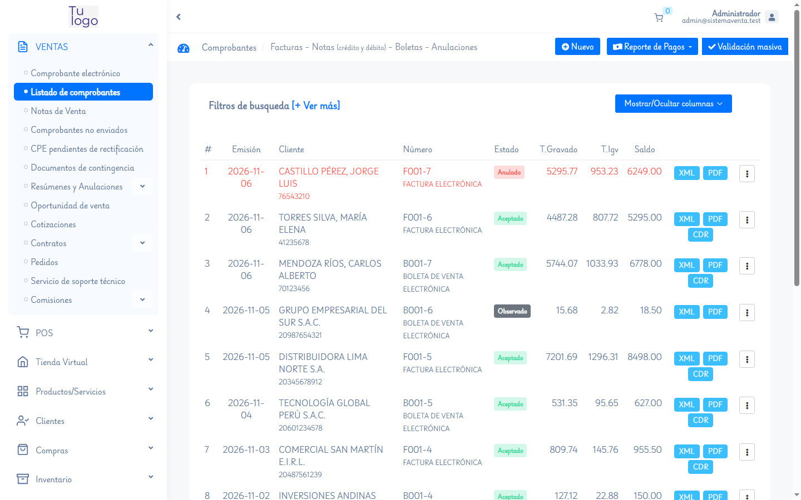

# SystemPe

**Sistema de facturación electrónica y gestión empresarial multi-tenant para Perú.**

Aplicación Laravel 5.7 con panel central de administración y múltiples empresas
(*tenants*) aisladas por subdominio y base de datos independiente. Incluye
comprobantes electrónicos SUNAT, inventario, compras, ventas, POS, hotelería,
finanzas, reportes y más.

[](https://www.php.net/)
[](https://laravel.com/)
[](https://vuejs.org/)
[](https://mariadb.org/)
[](#licencia-y-créditos)

---

## Capturas

A continuación se muestran 10 vistas representativas del sistema SystemPe
después de aplicar las optimizaciones de rendimiento, diseño responsive y
correcciones visuales. Todas fueron capturadas en el servidor en ejecución
(`php artisan serve --host=0.0.0.0 --port=8080`).

| Vista | Vista |
|---|---|
| <br>**Login del sistema.** Acceso al panel central con credenciales demo (`admin@gmail.com` / `123456`). | <br>**Login del tenant.** Acceso a una empresa aislada (`sistemaventa.systempe.test`). |
| <br>**Dashboard.** KPIs de certificados, CPE emitidos, ventas, notas, ingresos y utilidad, con paneles independientes y responsive. | <br>**Comprobantes.** Lista de comprobantes electrónicos con estado, fecha, cliente, total y botones XML, PDF y CDR. |
| <br>**Productos/Servicios.** Catálogo con categorías, marcas, precios e imágenes. | <br>**Clientes.** Gestión de personas con documento, teléfono y dirección. |
| <br>**POS.** Punto de venta con caja abierta, filtros por categoría y productos con imagen. | <br>**Hotelería.** Recepción con habitaciones por estado y tarifas asociadas. |
| <br>**Reportes.** Resúmenes de ventas, compras, inventario y finanzas. | <br>**Comprobante electrónico.** Detalle SUNAT con cliente, ítems, totales y descargas XML/PDF/CDR. |

> Las capturas se generan desde la aplicación en ejecución y viven en
> [`docs/capturas/`](docs/capturas/).
>
> El sistema incluye **modo claro y modo oscuro** globales; el selector de tema
> está en la cabecera (icono de luna/sol) y la preferencia se guarda en
> `localStorage`.

---

## ¿Qué incluye?

- **Panel central (`systempe.test`)**: clientes, planes, módulos, dominios,
  certificados, backups y estado del servicio.
- **Tenants aislados**: cada empresa tiene su propia base de datos
  (`tenancy_<subdominio>`), usuarios, series, almacenes y configuración.
- **Facturación electrónica SUNAT**: facturas, boletas, notas de crédito/débito,
  guías de remisión, retenciones, percepciones, resúmenes y anulaciones.
- **Ventas y compras**: cotizaciones, pedidos, comprobantes, pagos y cuentas por
  cobrar/pagar.
- **Inventario**: ítems, almacenes, kardex, transferencias, inventarios y
  productos farmacéuticos (DIGEMID).
- **POS y caja**: punto de venta, arqueos, ingresos y egresos.
- **Hotelería y restaurante**: habitaciones, reservas, check-in/out, pedidos.
- **Finanzas y reportes**: balances, flujo de caja, reportes de ventas,
  compras, inventario y utilidades.
- **Extras**: e-commerce, procedimientos documentarios, suscripciones, pagos
  con Mercado Pago y Culqi, consulta RUC/DNI con API Perú.

---

## Stack y versiones

| Componente | Versión usada |
|---|---|
| PHP | 7.4.33 |
| Laravel | 5.7.29 |
| MariaDB | 10.11.16 (compatible con MySQL 5.7/8) |
| Multi-tenant | `hyn/multi-tenant` 5.3.1 |
| Módulos | `nwidart/laravel-modules` 5.1.0 (28 módulos) |
| Frontend | Vue 2.7.16 + Element UI 2.13.x |
| Build | Laravel Mix 3 + webpack 3 |
| Node (solo para recompilar assets) | 18+ (probado con 24) |
| Composer | 2.x |
| Servidor de desarrollo | `php artisan serve` (PHP embebido) |

> **Importante:** el proyecto usa PHP 7.4. No funciona en PHP 8 sin adaptar
> dependencias antiguas (Laravel 5.7 y paquetes de la época).

---

## Requisitos

### Obligatorios

- **PHP 7.4** con las extensiones:
  `curl`, `fileinfo`, `gd2`, `intl`, `mbstring`, `exif`, `mysqli`,
  `openssl`, `pdo_mysql`, `pdo_sqlite`, `soap`, `sockets`, `sodium`,
  `sqlite3`, `xsl`, `zip`.
- **Composer 2**.
- **MariaDB 10.x** o **MySQL 5.7/8** (la app usa SQL específico de MySQL).
- **Windows / Linux / macOS**.
- 4 GB de RAM recomendados (2 GB mínimo).

### Opcionales

- **Node 18+** solo si vas a recompilar el JavaScript. El repositorio incluye
  los assets compilados de producción.
- **Git** para clonar el repositorio.

### Recomendado para desarrollo en Windows

- Activar **OPcache** en `php.ini` (ver [Rendimiento](#rendimiento)).
- Agregar exclusiones de **Windows Defender** para la carpeta del proyecto.
- Usar una consola con permisos de administrador solo para instalar servicios.

---

## Instalación paso a paso (Windows)

Sigue los pasos **en orden**. Cada bloque se ejecuta en PowerShell.

### 1. Instalar PHP 7.4

1. Descarga PHP 7.4 **VC15 x64** desde <https://windows.php.net/downloads/releases/archives/>.
2. Descomprime en una ruta sin espacios ni acentos, por ejemplo:
   `C:\php74`.
3. Agrega `C:\php74` al **PATH** del usuario.
4. Copia `php.ini-development` a `php.ini` y habilita las extensiones:

   ```ini
   extension_dir = "ext"
   extension=curl
   extension=fileinfo
   extension=gd2
   extension=intl
   extension=mbstring
   extension=exif
   extension=mysqli
   extension=openssl
   extension=pdo_mysql
   extension=pdo_sqlite
   extension=soap
   extension=sockets
   extension=sodium
   extension=sqlite3
   extension=xsl
   extension=zip

   ; Rendimiento
   zend_extension=php_opcache.dll
   opcache.enable=1
   opcache.memory_consumption=192
   opcache.max_accelerated_files=20000
   ```

5. Verifica:

   ```powershell
   php -v
   php -m
   ```

Debes ver `PHP 7.4.x` y las extensiones listadas.

### 2. Instalar Composer 2

```powershell
# Opción A: instalador oficial
# https://getcomposer.org/Composer-Setup.exe

# Opción B: manual
php -r "copy('https://getcomposer.org/installer', 'composer-setup.php');"
php composer-setup.php
php -r "unlink('composer-setup.php');"
```

Verifica:

```powershell
composer --version
```

### 3. Instalar y arrancar MariaDB

1. Instala MariaDB 10.11 desde <https://mariadb.org/download/>.
2. Inicia el servicio (o `mysqld` en una consola).
3. Crea la base del sistema:

   ```sql
   CREATE DATABASE tenancy
     CHARACTER SET utf8mb4
     COLLATE utf8mb4_unicode_ci;
   ```

4. Crea un usuario para la aplicación (recomendado, no uses `root` en producción):

   ```sql
   CREATE USER 'systempe'@'127.0.0.1' IDENTIFIED BY 'CAMBIA_ESTA_CLAVE';
   GRANT ALL PRIVILEGES ON tenancy.* TO 'systempe'@'127.0.0.1';
   GRANT ALL PRIVILEGES ON `tenancy\_%`.* TO 'systempe'@'127.0.0.1';
   FLUSH PRIVILEGES;
   ```

   El segundo `GRANT` permite que el sistema cree y administre las bases de
   cada tenant.

### 4. Clonar el proyecto

```powershell
git clone <URL-DEL-REPOSITORIO> systempe
cd systempe
```

### 5. Instalar dependencias PHP

```powershell
composer install --no-interaction
composer check-platform-reqs
```

`check-platform-reqs` debe terminar todo en `success`. Si falla, falta una
extensión de PHP.

### 6. Configurar el entorno

```powershell
copy .env.example .env
php artisan key:generate
```

Edita `.env` con estos valores mínimos:

```dotenv
APP_NAME=SystemPe
APP_ENV=local
APP_DEBUG=true
APP_URL=http://systempe.test:8080
APP_URL_BASE=systempe.test

DB_CONNECTION=mysql
DB_HOST=127.0.0.1
DB_PORT=3306
DB_DATABASE=tenancy
DB_USERNAME=systempe
DB_PASSWORD=CAMBIA_ESTA_CLAVE

CACHE_DRIVER=file
SESSION_DRIVER=file
QUEUE_CONNECTION=database

PREFIX_DATABASE=tenancy
TENANCY_DATABASE_AUTO_DELETE=false
TENANCY_DATABASE_AUTO_DELETE_USER=false
```

> `TENANCY_DATABASE_AUTO_DELETE=false` evita que se borren bases de datos al
> eliminar un tenant. No lo cambies en producción.

### 7. Crear el esquema del sistema

```powershell
php artisan migrate --seed
```

Esto crea las tablas del sistema y siembra:

- Usuario administrador: `admin@gmail.com` / `123456`
- Plan inicial y tipos de documento

> Ejecuta `--seed` **solo la primera vez**. Si necesitas volver a sembrar:
> `php artisan db:seed`.

Verifica:

```powershell
php artisan migrate:status
```

### 8. Enlazar el almacenamiento público

```powershell
php artisan storage:link
```

En Windows, si falla por permisos, crea una *junction*:

```powershell
cmd /c mklink /J public\storage storage\app\public
```

Comprueba que `public\storage\skins\light.css` exista.

### 9. Registrar los dominios locales

Edita `C:\Windows\System32\drivers\etc\hosts` **como administrador** y agrega:

```text
127.0.0.1 systempe.test
127.0.0.1 sistemaventa.systempe.test
127.0.0.1 hotelprueba.systempe.test
127.0.0.1 econocomercio.systempe.test
```

> Cada tenant nuevo necesita su propia línea o un dominio comodín
> (`*.systempe.test`) si usas un servidor DNS local.

### 10. Optimizar la configuración

```powershell
php artisan config:cache
php artisan view:clear
```

> Cada vez que cambies `.env` ejecuta `php artisan config:clear` y vuelve a
> cachear. Si el proyecto está en desarrollo activo, puedes omitir
> `config:cache`.

### 11. Arrancar el sistema

```powershell
php artisan serve --host=0.0.0.0 --port=8080
```

O usa el script incluido:

```powershell
.\iniciar-systempe.bat
```

Abre:

- Panel del sistema: <http://systempe.test:8080/login>
- Tenant de ejemplo: <http://sistemaventa.systempe.test:8080/login>

### 12. Crear un tenant (empresa)

1. Entra al panel del sistema con `admin@gmail.com` / `123456`.
2. Ve a **Clientes → Nuevo**.
3. Completa subdominio, razón social, RUC, correo, contraseña, plan y módulos.
4. Guarda. El sistema crea automáticamente:
   - La base `tenancy_<subdominio>`.
   - Las 259 tablas del tenant y sus datos iniciales.
   - La empresa, configuración, establecimiento, almacén y series.
   - El usuario administrador del tenant con el correo y contraseña indicados.
5. Entra a `http://<subdominio>.systempe.test:8080/login`.

Si aparece un error de acceso MySQL del tenant:

```powershell
php scripts\crear-usuarios-tenant.php
```

---

## Instalación en Linux (resumen)

```bash
# Paquetes base
sudo apt install php7.4-fpm php7.4-cli php7.4-mysql php7.4-mbstring \
  php7.4-xml php7.4-curl php7.4-gd php7.4-intl php7.4-zip php7.4-soap \
  mariadb-server nginx git unzip

# Proyecto
git clone <URL-DEL-REPOSITORIO> /var/www/systempe
cd /var/www/systempe
composer install --no-interaction
cp .env.example .env
php artisan key:generate

# Base de datos
sudo mysql -e "CREATE DATABASE tenancy CHARACTER SET utf8mb4 COLLATE utf8mb4_unicode_ci;"

# Esquema y enlaces
php artisan migrate --seed
php artisan storage:link

# Permisos
sudo chown -R www-data:www-data storage bootstrap/cache
sudo chmod -R ug+rwx storage bootstrap/cache

# Nginx: server_name systempe.test *.systempe.test;
# root /var/www/systempe/public;
# fastcgi_pass unix:/run/php/php7.4-fpm.sock;
```

En `/etc/hosts` (o DNS local) apunta los dominios a `127.0.0.1`.

---

## Cómo funciona el multi-tenant

```text
Navegador
   │  Host: sistemaventa.systempe.test
   ▼
Laravel + hyn/multi-tenant
   │  busca el hostname en `tenancy.hostnames`
   ▼
Website → base de datos `tenancy_sistemaventa`
   │
   ▼
Modelos App\Models\Tenant\* (conexión `tenant`)
```

- **Sistema central** (`systempe.test`): base `tenancy`, modelos
  `App\Models\System\*`, conexión `system`.
- **Tenant** (`<subdominio>.systempe.test`): base `tenancy_<subdominio>`,
  modelos `App\Models\Tenant\*`, conexión `tenant`.
- El middleware identifica el `hostname`, carga el `website` y cambia la
  conexión `tenant` antes de atender la petición.
- La contraseña del usuario MySQL de cada tenant se deriva de:

  ```text
  md5(APP_KEY + "." + id_del_website)
  ```

  Por eso, si cambias `APP_KEY`, debes recrear los usuarios:

  ```powershell
  php scripts\crear-usuarios-tenant.php
  ```

---

## Cuentas demo

| Acceso | URL | Correo | Contraseña |
|---|---|---|---|
| Sistema central | <http://systempe.test:8080/login> | `admin@gmail.com` | `123456` |
| Tenant Sistemaventa | <http://sistemaventa.systempe.test:8080/login> | `admin@sistemaventa.test` | `123456` |
| Tenant Hotelprueba | <http://hotelprueba.systempe.test:8080/login> | `admin@hotelprueba.test` | `123456` |
| Tenant EconoComercio | <http://econocomercio.systempe.test:8080/login> | `admin@econocomercio.test` | `123456` |

> **Seguridad:** estas cuentas son solo para desarrollo/demo. Cámbialas antes de
> publicar el sistema en internet.

---

## Comandos útiles

| Comando | Para qué |
|---|---|
| `php artisan migrate:status` | Estado de las migraciones del sistema |
| `php artisan config:clear` | Recargar `.env` |
| `php artisan config:cache` | Cachear configuración (producción) |
| `php artisan view:clear` | Limpiar vistas compiladas |
| `php artisan cache:clear` | Limpiar caché de aplicación |
| `php artisan storage:link` | Enlazar `public/storage` |
| `php artisan serve --host=0.0.0.0 --port=8080` | Servidor de desarrollo |
| `npm run assets:prod` | Recompilar JS minificado |
| `npm run assets` | Recompilar JS de desarrollo |
| `php scripts\crear-usuarios-tenant.php` | Reparar usuarios MySQL de tenants |
| `php artisan queue:work` | Procesar colas |
| `php artisan schedule:run` | Ejecutar tareas programadas |

---

## Estructura del proyecto

```text
systempe/
├── app/
│   ├── CoreFacturalo/        # XML UBL, firma digital, SUNAT, PDF
│   ├── Http/                 # Controladores, middleware y requests
│   ├── Models/
│   │   ├── System/           # Modelos del panel central (conexión system)
│   │   └── Tenant/           # Modelos de cada empresa (conexión tenant)
│   └── Providers/
├── bootstrap/cache/          # Cachés de Laravel (no se versionan)
├── config/                   # Configuración (app, tenancy, tenant, etc.)
├── database/
│   ├── migrations/           # Migraciones del sistema
│   ├── migrations/tenant/    # Migraciones de cada tenant
│   └── seeds/                # Seeders del sistema y de tenants
├── docs/                     # Documentación e imágenes
│   ├── capturas/             # Capturas para el README
│   ├── diagramas/            # Diagramas .drawio
│   └── sql/                  # Inventario de tablas (dumps locales, no versionados)
├── modules/                  # 28 módulos de negocio (nwidart)
├── public/                   # Document root (assets compilados)
├── resources/
│   ├── js/                   # Vue 2 + Element UI
│   └── views/                # Blade (sistema y tenant)
├── routes/web.php            # Rutas del sistema y de tenants
├── scripts/                  # Utilidades (usuarios, assets, Defender, dumps)
├── storage/                  # Logs, caché, archivos de tenants
└── tests/
```

---

## Build de assets

El repositorio incluye los assets de producción compilados, así que **no
necesitas Node para ejecutar** el sistema. Solo si modificas JS/Vue:

```powershell
npm install --ignore-scripts
npm run assets:prod
```

- `npm run assets:prod` genera `public/js/app.js`, `vendor.js`, `manifest.js`
  minificados y actualiza `public/mix-manifest.json`.
- `npm run assets` genera una build de desarrollo (más pesada, con `eval`).
- El CSS se sirve ya compilado desde `public/css/`; el build solo recompila JS.

---

## Rendimiento

Configuración aplicada y recomendada en Windows:

1. **OPcache activado** (la mejora más grande):

   ```ini
   zend_extension=php_opcache.dll
   opcache.enable=1
   opcache.memory_consumption=192
   opcache.max_accelerated_files=20000
   opcache.validate_timestamps=1
   opcache.revalidate_freq=2
   ```

2. **Exclusiones de Windows Defender** para el proyecto, PHP y MariaDB.
   Ejecuta como administrador:

   ```powershell
   .\scripts\excluir-defender.ps1
   ```

3. **Caché de configuración**:

   ```powershell
   php artisan config:cache
   ```

4. **Assets minificados** (incluidos): `npm run assets:prod`.

5. **Servidor**: `php artisan serve` usa el servidor embebido de PHP y atiende
   **una petición a la vez** en Windows. Para producción usa Nginx o Apache con
   PHP-FPM.

Medición de referencia en este equipo (login, después de OPcache):

| Escenario | Antes | Después |
|---|---|---|
| Login del sistema | ~2,2 s | **~0,7 s** |
| Login de tenant | ~1,9 s | **~0,4 s** |

---

## Seguridad

- **Nunca subas `.env`** al repositorio. Contiene `APP_KEY`, credenciales de
  base de datos y tokens.
- Genera una `APP_KEY` propia con `php artisan key:generate`.
- Cambia las contraseñas demo antes de publicar.
- En producción:
  - `APP_ENV=production`
  - `APP_DEBUG=false`
  - HTTPS obligatorio.
- No publiques los dumps SQL: contienen datos y hashes. Se generan localmente
  (ver [`docs/sql/README.md`](docs/sql/README.md)).
- Los certificados digitales y archivos de tenants viven en `storage/` y no se
  versionan.
- Si cambias `APP_KEY` en una instalación con tenants, ejecuta
  `php scripts\crear-usuarios-tenant.php` para recalcular las contraseñas MySQL.

---

## Solución de problemas

| Síntoma | Causa | Solución |
|---|---|---|
| `Unable to locate Mix file: /css/app.css` | Falta `public/mix-manifest.json` | `npm run assets:prod` |
| 404 en `/storage/...` | Falta el enlace público | `php artisan storage:link` o `mklink /J` |
| `Access denied for user 'tenancy_...'` | Usuario MySQL del tenant desactualizado | `php scripts\crear-usuarios-tenant.php` |
| `Table 'tenancy.modules' doesn't exist` | Migraciones del sistema sin ejecutar | `php artisan migrate` |
| `419 Page Expired` | Sesión/CSRF vencido | Recarga con `Ctrl+F5` |
| `Port 8080 already in use` | Ya hay un servidor PHP | Cierra el otro proceso o usa otro puerto |
| `Node Sass does not yet support...` | `node-sass` incompatible con Node moderno | `npm run assets:prod` (usa dart-sass) |
| `error:0308010C:digital envelope routines::unsupported` | webpack 3 con Node 18+ | Usa el script incluido (`--openssl-legacy-provider`) |
| `Vue packages version mismatch` | Versiones distintas de Vue | Mantén `vue` y `vue-template-compiler` en `2.7.16` |
| 403 al crear documentos | Empresa en modo SOAP `03` | Cambia a modo demo `01` en la configuración |
| Todo se siente lento | OPcache desactivado | Actívalo y reinicia PHP |

---

## Documentación adicional

| Documento | Contenido |
|---|---|
| [Instalación desde cero](docs/INSTALACION-DESDE-CERO.md) | Guía extendida con capturas y verificación |
| [Cómo funciona el sistema](docs/COMO-FUNCIONA-EL-SISTEMA.md) | Arquitectura, rutas, modelos y flujo |
| [Tecnologías y versiones](docs/TECNOLOGIAS-Y-VERSIONES.md) | Detalle del stack |
| [Cuentas y arranque](docs/CUENTAS-Y-ARRANQUE.md) | Servicios, puertos y credenciales locales |
| [Scripts SQL](docs/sql/README.md) | Inventario de tablas y generación de dumps |
| [Diagramas](docs/diagramas/README.md) | Diagramas de arquitectura en `.drawio` |
| [Integración draw.io MCP](docs/MCP-DRAWIO.md) | Generación automatizada de diagramas |
| [Legado Facturador PRO](docs/LEGADO-FACTURADOR.md) | README original y sus términos |

---

## Licencia y créditos

Este proyecto se distribuye bajo licencia **MIT** (ver [`LICENSE`](LICENSE)).

Está construido sobre **Facturador PRO 5** de
[facturaloperu.com](https://facturaloperu.com). Se conservan sus términos y
condiciones originales, disponibles en
[`docs/LEGADO-FACTURADOR.md`](docs/LEGADO-FACTURADOR.md):

1. Se permite la distribución y/o modificación haciendo referencia a
   [facturaloperu.com](https://facturaloperu.com).
2. La sección de términos y condiciones no puede removerse al compartir o
   distribuir el repositorio.
3. Para distribuir el código como propio se requiere al menos un 30 % de
   modificaciones, validado previamente por facturaloperu.com.
4. El uso funcional es marca blanca; la distribución del código debe conservar
   esta sección.
5. facturaloperu.com no se hace responsable por daños derivados del uso del
   código cuando no fue distribuido directamente por ellos.
